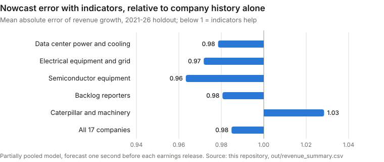

# Industrial Intelligence

Public operational data mapped to industrial companies and tested, **point in time**, against what the
companies later reported. The platform collects factory orders, power-plant pipelines, grid demand,
customers' capital spending, construction registrations, tenders, hiring and trade; links each series to the
companies and segments it should drive; and asks whether it estimates revenue and margins *before* the
company reports them better than the company's own history does.

**Interactive dashboard:** <https://rasmuscodes.github.io/apps/industrial-intelligence/> ·
**Write-up:** <https://rasmuscodes.github.io/projects/industrial-intelligence/>

<!-- RESULTS-START -->
## Results in brief

17 companies modelled from SEC filings (ABB, Siemens Energy and Schneider Electric mapped only); 59 operational
indicators from 11 public sources, stored as 102,593 point-in-time rows; 1,935 evaluated walk-forward forecasts per
model across three horizons, 2016–2026. Every number below is in [docs/RESULTS.md](docs/RESULTS.md).



1. **A small, real nowcast gain.** One second before each earnings release, the partially pooled indicator model
   misses reported revenue growth by 7.39 percentage points on average in the 2021–26 holdout, against 7.50 for
   the company's own history and 7.82 for a random walk (1.5% better than history; Clark-West p = 0.002 that the
   indicators add information; Diebold-Mariano p = 0.23, so the accuracy gain itself is not significant). In
   2016–20 there was no gain.
2. **Where it works.** Holdout gains of 2–4% for data center suppliers, grid equipment makers, chip-tool makers and
   backlog reporters (Clark-West p ≤ 0.02 each); none for Caterpillar, Cummins and United Rentals (3% worse).
3. **Coincident, not leading.** One and two quarters before a release the indicators add nothing (error ratio 1.00
   and 1.02), and the same indicator lagged a quarter adds nothing at the nowcast either. The one series that does
   lead, US construction-machinery orders for Caterpillar (out-of-sample R² +0.17 to +0.24 at all three horizons),
   does not survive a correction for the ~135 single-indicator tests, so it is a hypothesis to test next.
4. **Point in time matters.** Run on today's revised data with no publication lags, the same backtest reports a
   2.6% holdout gain instead of 1.5%: a careless backtest overstates the result by about 70%.
5. **More model is worse.** Gradient boosting (14% worse than history) and a ridge on each indicator separately (24%
   worse) overfit 650 company-quarters; the simple pooled composite is the best model.
6. **Backlogs.** Conversion ratios (revenue / prior-quarter remaining performance obligations) fell at all ten
   companies that report them, by 1–23% a year since 2019, so every backlog-to-revenue rule loses to history
   (1.04 to 4.3 times the error). The indicators do nowcast *implied order intake* 2.9% better than history
   (Clark-West p = 0.0003).
7. **Margins.** Industry price and cost indexes do not beat mean reversion for gross or operating margin changes.
8. **Calibrated uncertainty.** 80% predictive intervals contained 77% of outcomes in 2016–20 and 83% in 2021–26.
9. **No excess returns.** The indicators' extra information does not predict earnings-announcement returns (t = −0.45)
   or the drift into the release (t = 1.56) for 12 companies with CRSP data through 2024; the test has little power.

Case studies: [data center power and cooling](docs/case_studies/01_data_center_power_cooling.md) ·
[Caterpillar](docs/case_studies/02_caterpillar_equipment_demand.md) ·
[electrical equipment and grid](docs/case_studies/03_electrical_equipment_grid.md) ·
[backlogs and conversion](docs/case_studies/04_backlog_conversion.md).
<!-- RESULTS-END -->

## What is in the repository

| Path | What it is |
|---|---|
| [`indintel/sources/`](indintel/sources) | Connectors: SEC EDGAR (XBRL facts, segment instances, filings, press releases), ALFRED vintages, EIA-860M / EIA-930 / EIA-861M, Census construction, interconnection queues, Texas TABS, EU TED, Indeed Hiring Lab, UN Comtrade, USAspending |
| [`indintel/http.py`](indintel/http.py) | One polite client for all connectors: robots.txt, per-host throttling, raw cache with a SHA-256 fetch log |
| [`indintel/store.py`](indintel/store.py), [`fundamentals.py`](indintel/fundamentals.py), [`indicators.py`](indintel/indicators.py), [`panel.py`](indintel/panel.py) | Point-in-time store, XBRL vintage replay, as-of feature engine, company-quarter panel |
| [`config/`](config) | Universe, indicator registry, **company mapping database** (links + cited profiles), source registry |
| [`indintel/models.py`](indintel/models.py), [`backtest.py`](indintel/backtest.py), [`evaluate.py`](indintel/evaluate.py) | Forecasting engine: baselines, regression, partially pooled Bayesian, ridge, gradient boosting, backlog models; walk-forward and tests |
| [`indintel/returns.py`](indintel/returns.py) | The separate question of excess stock returns (needs local CRSP data) |
| [`indintel/export.py`](indintel/export.py) | JSON bundle for the static dashboard |
| [`docs/`](docs) | Methodology, data sources, company mapping, indicator registry, results, case studies |
| [`out/`](out) | Result tables (CSV) produced by the last full run |
| [`tests/`](tests) | Unit tests on synthetic data plus point-in-time checks on the built data (skipped on a fresh clone) |

Not in the repository: downloaded and built data (`data/`, about 3 GB, rebuilt by the pipeline), and anything
from CRSP (licensed).

## Documents

- [Methodology](docs/METHODOLOGY.md): point-in-time design, models, walk-forward protocol, tests
- [Data sources](docs/DATA_SOURCES.md): ranking, access notes, what was not used and why
- [Company mapping](docs/COMPANY_MAPPING.md): segments, drivers, geography, customers, backlog, pricing, margin drivers, with quoted evidence
- [Indicator registry](docs/INDICATORS.md) and [results tables](docs/RESULTS.md)
- Case studies: [1 Data center power and cooling](docs/case_studies/01_data_center_power_cooling.md) ·
  [2 Caterpillar equipment demand](docs/case_studies/02_caterpillar_equipment_demand.md) ·
  [3 Electrical equipment and grid investment](docs/case_studies/03_electrical_equipment_grid.md) ·
  [4 Order backlogs and conversion](docs/case_studies/04_backlog_conversion.md)

## Running it

Python 3.11 or newer.

```
python -m venv .venv
.venv\Scripts\activate            # or: source .venv/bin/activate
pip install -r requirements.txt
pip install -e .
python -m pytest -q               # unit tests; data tests skip until data is built
```

Full rebuild (downloads take about an hour; EDGAR needs a declared contact in `SEC_USER_AGENT`, e.g.
`"Your Name you@example.com"`, per the SEC's fair-access policy):

```
python -m indintel fetch all
python scripts/run_all.py                    # datasets -> panel -> backtests -> dashboard bundle
python scripts/make_docs.py                  # regenerate docs/RESULTS.md, COMPANY_MAPPING.md, INDICATORS.md
python -m indintel verify-mapping            # every profile quote against the filing text
```

`python scripts/run_all.py` rebuilds from the raw cache without network access. The returns step runs only
when `INDINTEL_CRSP_DIR` points at a local CRSP extract. `python -m indintel export-dashboard <dir>` writes the
dashboard data to another folder.

## Licence

MIT. Data remain under their providers' terms (listed in [docs/DATA_SOURCES.md](docs/DATA_SOURCES.md)); the
Indeed Hiring Lab series are CC BY 4.0, attribution Indeed Hiring Lab.
